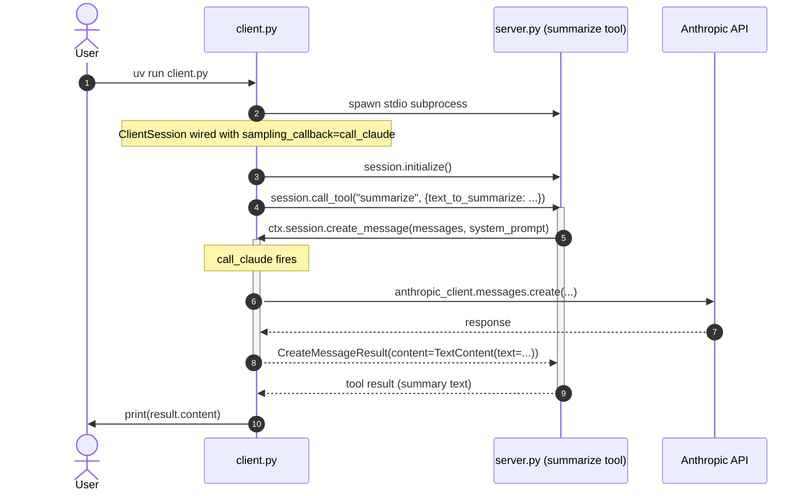

# Sampling

The server's `summarize` tool needs an LLM but does not talk to one directly.
It sends a sampling request back to the client,
which supplies the LLM via `sampling_callback` and returns the result.



Walkthrough of the key moments:

- **Steps 1-4**: the user starts the client, which spawns the server (stdio transport),
  connects via `ClientSession` wiring `call_claude` as the sampling callback,
  and calls the `summarize` tool.
- **Steps 5-8 (the reversal)**: the tool needs an LLM but the server does not call Anthropic
  itself. It sends a sampling request back to the client via `ctx.session.create_message`.
  The client's `call_claude` fires, hits the Anthropic API, and returns the result
  as a `CreateMessageResult`.
- **Steps 9-10**: the server returns the model's text as the tool's final value;
  the client prints it.

## Running

See the project root `README.md` for setup. From there:

```
cd 1-sampling
uv run client.py
```
