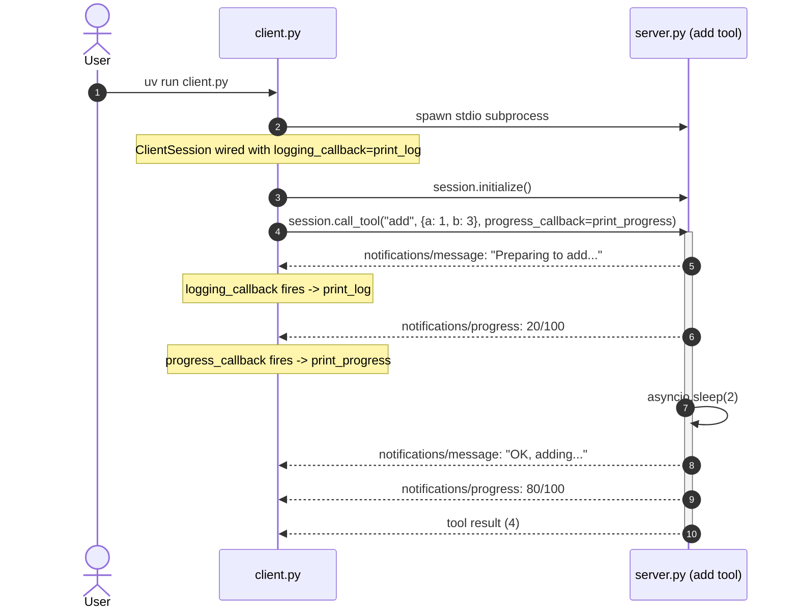

# Notifications

The `add` tool is contrived (a slow sum) to show two out-of-band event streams
the server can push while a tool runs. The client wires each with its own callback:
`logging_callback` on `ClientSession` for log messages,
and `progress_callback` on the specific `call_tool` invocation for progress updates.
Both fire concurrently with the tool's work, not after.



Walkthrough of the key moments:

- **Steps 1-4**: the user starts the client, which spawns the server (stdio transport),
  connects via `ClientSession` wiring `print_log` as the logging callback,
  and calls the `add` tool wiring `print_progress` as the progress callback.
- **Steps 5-9 (the two streams)**: the server pushes `ctx.info` log messages (steps 5, 8)
  and `ctx.report_progress` updates (steps 6, 9) while it works.
  Each kind lands on its own callback: `logging_callback` on `ClientSession` is session-wide;
  `progress_callback` on `call_tool` is per-call.
  Both fire concurrently with the tool's work.
- **Step 10**: the tool returns its final value (`4`) through the normal `call_tool`
  response channel.

## Running

See the project root `README.md` for setup. From there:

```
cd 2-notifications
uv run client.py
```
