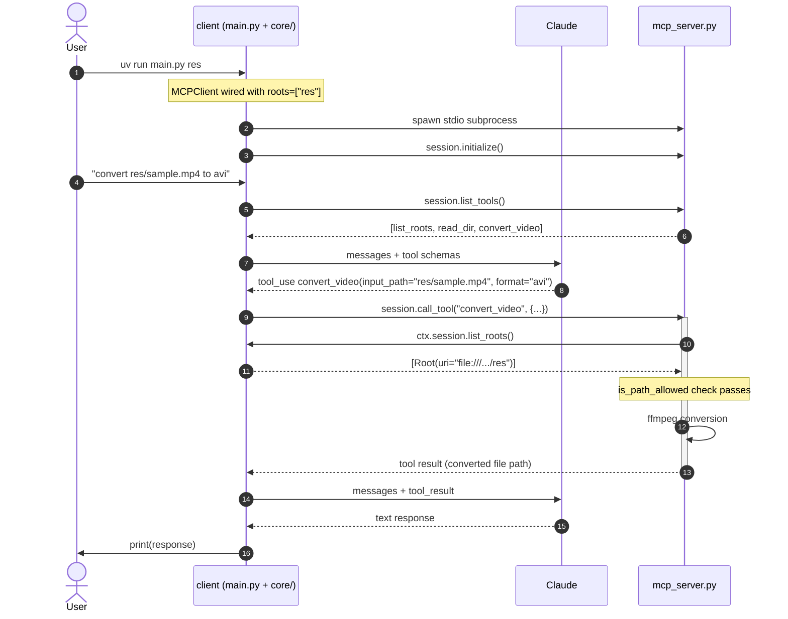

# Roots

The client declares a set of filesystem roots when it starts.
The server exposes tools that touch files, but any tool that takes a path first asks
the client "is this path inside one of your roots?" via `ctx.session.list_roots()`.
Paths outside the declared roots are rejected before the tool runs.

This is the first demo that is a full application rather than a two-file script:
`main.py` composes an `MCPClient` (declaring the user's roots as a startup arg),
a `Claude` wrapper, and a `CliChat` + `CliApp` that drive an interactive chat loop
with tool use.



Walkthrough of the key moments:

- **Steps 1-9**: the user starts the client with `uv run main.py res`,
  which registers `res/` as a root; the client spawns the server, initializes the session,
  takes a chat prompt, fetches tool schemas from the server, and passes them to Claude.
  Claude decides to call `convert_video`.
- **Steps 10-11 (the roots check)**: before touching the file, the server calls
  `ctx.session.list_roots()` back to the client.
  The client answers with the registered roots.
  `is_path_allowed` verifies the input path is within one of them;
  if not, the tool raises before ffmpeg runs.
- **Steps 12-16**: ffmpeg converts the file; the result flows back to Claude;
  Claude replies in natural language; the client prints.

## Tools

- `list_roots` — returns the roots the client exposed.
- `read_dir` — list contents of a directory (must be within a root).
- `convert_video` — convert MP4 to another format (requires FFmpeg on PATH).

## Running

See the project root `README.md` for setup. You also need FFmpeg
(`brew install ffmpeg` / `apt install ffmpeg`) for the `convert_video` tool.

Run from this folder, passing one or more root directories as arguments:

```
cd 3_roots
uv run main.py res
```

A `res/` folder with a small `sample.mp4` is included for the `convert_video` tool.
You can also pass arbitrary paths:

```
uv run main.py /path/to/videos ~/Documents
```
