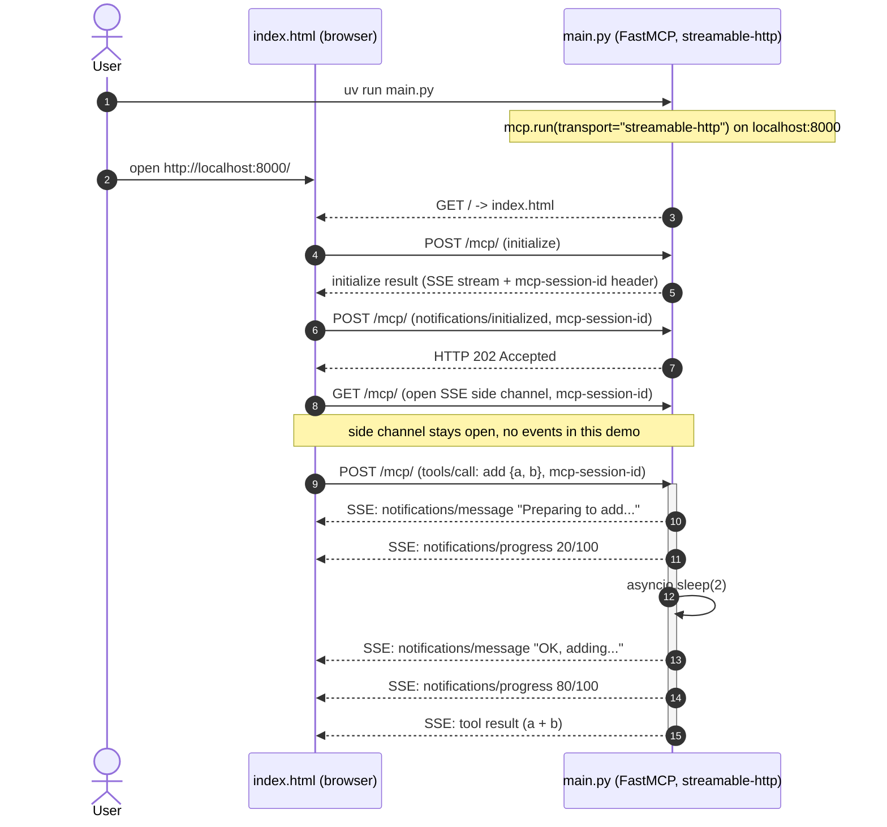

# Transport over HTTP

The first three demos run the server as an stdio subprocess spawned by a Python client.
This one swaps the transport: the server runs as an HTTP server over `streamable-http`,
and the client is a self-contained browser page (`index.html`) that talks to it with plain
`fetch` calls. Nothing on the server side is Python-client-specific — the browser is a
first-class MCP client.

The `FastMCP` flags `stateless_http` and `json_response` are the chapter's main point.
They are left commented out in `main.py` so the demo exercises the full default behavior:
`streamable-http` keeps a per-client session (`mcp-session-id` header) and
streams tool responses as Server-Sent Events — which `index.html` is written to handle.
Setting both to `True` would collapse everything to stateless plain-JSON responses,
simpler for a bare-bones browser client but hiding what the transport actually does.



Walkthrough of the key moments:

- **Steps 1-3**: the user starts the server, opens the page, and the server returns `index.html` from `GET /`.
- **Steps 4-7 (the handshake)**: the browser POSTs `initialize` and gets the session id back on an SSE response;
  it POSTs `notifications/initialized` and the server replies `HTTP 202 Accepted`.
- **Step 8 (the side channel)**: the browser opens a persistent `GET /mcp/` SSE stream for server-initiated messages;
  stays silent in this demo.
- **Steps 9-15 (the tool call)**: the browser calls `add` with the session id;
  the server pushes two log messages (`ctx.info`) and two progress updates (`ctx.report_progress`) during execution,
  then returns the sum (`8`) as the tool result — all as events on the same POST response SSE stream.

## Running

See the project root `README.md` for setup. From there:

```
cd 4_transport_http
uv run main.py
```

Then in a browser:

1. Open `http://localhost:8000/`. Must be `localhost`, not `127.0.0.1` — the HTML hardcodes
   `http://localhost:8000/mcp/` as the fetch target, so a mismatched host would make every
   request cross-origin and trigger a CORS preflight the server does not answer.
2. Click **Send Initialize Request**. The response card shows the server's capabilities and
   the `mcp-session-id` header; the session id auto-fills in the three cards below.
3. Click **Send Initialized Notification**. Server replies `HTTP 202 Accepted`.
4. Click **Start GET SSE**. Opens the side channel; stays silent in this demo.
5. Click **Call Add Tool**. The Tool Call Response panel shows the full SSE stream from the POST
   — two `notifications/message` (log), two `notifications/progress`, and the final result (`8`).
